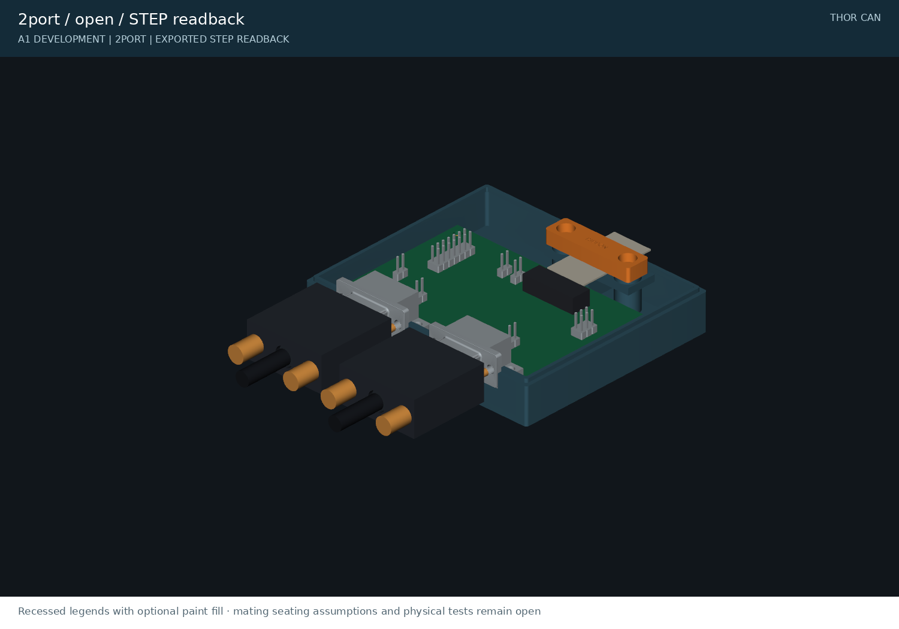

# Assembly and prototype checks

A1 is a fit-check and electrical-evaluation prototype. Read the [release checklist](docs/release-checklist.md) before connecting an expensive host.

## Parts per unit

| Item | Quantity | Notes |
|---|---:|---|
| Matching two- or four-port PCB | 1 | Default shunts OPEN |
| Matching printed base and lid | 1 each | PETG baseline, 0.2 mm layers |
| Printed `ribbon_clamp` | 1 | Same part for both variants |
| Samtec FFSD-13-D-04.00-01-N cable | 1 | Candidate; mating/continuity test required |
| M3 × 20 socket-head screws | 4 | Shared lid/PCB retention; head Ø5.5 × 3 mm |
| M3 × 6 socket-head screws | 2 | Ribbon clamp; head Ø5.5 × 3 mm |
| Silicone foam washers, OD7/ID3.4×1mm | 4 | Compliant PCB retention under lid sleeves |
| McMaster 94459A130 M3 heat-set inserts | 6 | 4.3 mm installed length; four PCB supports, two clamp stops |
| Assmann A-DF09LL/Z female + A-FT09 hood | 2 or 4 | Demonstration mating set; hood includes #4-40 thumbscrews |
| Adhesive silicone foam pads | 2 | 18 × 6 × 0.8 mm; qualify adhesive/compression |
| Optional removable 2.54 mm shunts | As needed | Termination/power/shield; ship detached |

## 1. Print coupons before the full housing

Print `fastener_coupon` and `port_coupon` first. The coupon provides 3.8/3.9/4.0 mm insert pilots and 6.2/6.4/6.6 mm head counterbores. Default insert pilot is 4.0 mm; default counterbore is Ø6.4 × 3.3 mm, recessing a 3 mm socket head by 0.3 mm. McMaster's current catalog lists 4 mm as the maximum hole diameter for 94459A130; confirm the received insert and process on a coupon. The 4.7 mm knurl envelope comes from cad-agent's vendored reference table and needs sample verification.

Install all six heat-set inserts before adding electronics. Use a controlled insertion tip; seat tops 0.1 mm below the support faces, keep axes square, then allow complete cooling. Do not force a cold insert into a printed pilot. Coupon installation, torque, pull-out and repeated-service testing remain open. Do not drill larger than the validated coupon size.

Base prints floor-down; lid prints roof-down; clamp prints with its smooth pad face down. Exported STL/3MF files already have these orientations and Z=0. Use approximately four perimeters, 0.2 mm layers and 30% infill as a starting profile. These are proposed settings, not a validated slicer preset. Inspect bridging under the clamp deck, engraved lettering and screw sleeves. Each part fits a 256 mm bed. No slicer or physical print has been run by this project yet.

## 2. Inspect the bare assembly

Inspect solder joints and connector key orientation. Compare DE9 pin numbering with the schematic from the mating face, not from a memorized rear-view diagram. Meter the unpowered assembly: verify all intended nets, every NC pin, no H/L-to-ground short, and no exported host supply with JP5/JP6 open. The TVS makes simple resistance readings polarity-dependent; compare against a known-good first article.

Seat the PCB on its four supports. The board nominal underside is Z7.4 mm, top Z9.0 mm. Tail clearance below the board is 5 mm. Both housings include 0.6 mm nominal outline clearance and a 1.6 mm tall perimeter tongue, 0.25 mm nominal groove clearance per side, interrupted at connector openings. Check that no component, solder tail or connector shell touches plastic unexpectedly.

## 3. Install the cable clamp

The rear chamber keeps clamp screws away from the PCB. The two clamp inserts have tops at Z16.1 mm and bottoms at Z11.8 mm. Apply one silicone pad to the flat lower shelf and one to the clamp underside. Keep adhesive off contacts and conductors. The pads stay within the marked central ribbon region, clear of both screw stops.

With Thor disconnected, mate the ribbon connector to J1, route it gently through the rear slot and leave relaxed slack between J1 and the clamp. The rendered cable is a nominal route envelope, not a measured connector/strain-relief model. Do not crease the ribbon, force it against the header, or assume the shown route establishes the cable's minimum bend radius.

Fit the bar with two M3×6 socket-head screws and tighten evenly until its ends seat on the hard stops. Do not use longer screws. The 1.8 mm hard gap with two 0.8 mm pads and an assumed 0.6 mm ribbon gives 25% nominal pad compression. Measure the actual jacket and check the pad manufacturer's compression range before use; adjust gap/pads if necessary. Never use screw torque to compensate for the wrong stack thickness.

A sample cable must pass the planned **10 N axial pull for 60 seconds**, without slipping at the clamp, pulling on J1, conductor damage or failed continuity. This is a proposed acceptance target, not a tested load rating. Repeat after a warm dwell to expose pad/filament creep. Test on a disconnected assembly, with no load on Thor.

## 4. Configure and close

Identify the bus endpoints. Enable the host termination only where needed: JP1 for CAN0, JP2 for CAN1; JP3/JP4 only on a verified four-channel host. The carrier-side 120 Ω is between L and TERM; each shunt joins H to TERM. Two correctly terminated endpoints read approximately 60 Ω H-to-L on an otherwise unpowered bus.

Leave JP5/JP6 open unless a documented internal auxiliary load requires the host rails and its current limit is verified. J12 shield bonding is a system-grounding choice. The auxiliary header is raw and unprotected; keep it internal unless a separately designed interface handles the environment.

Seat the perimeter tongue in the lid groove and use four M3×20 socket-head screws. Fit four1mm silicone foam washers around the mount screws, between the PCB and lid sleeves. The sleeves leave a0.8mm gap at nominal board thickness, giving20% nominal washer compression; this accommodates board-thickness variation without a rigid plastic clamp on the PCB. The lid screws have 3.8 mm nominal insert overlap and 1.2 mm tip clearance above the blind-hole floor; clamp screws have 3.6 mm overlap and 1.4 mm tip clearance. These nominal stacks are CAD checks, not load or torque ratings. Tighten gently; insert pull-out and repeated service life remain physical tests. Check that the lid does not pinch the cable. The roof engraves CAN0/CAN1 (RES2/RES3 on four-port), CAN pinout, A1 development revision and github.com/mvalancy. Confirm labels against the schematic before electrical testing.

## 5. Bench acceptance

Use a known-good, current-limited CAN test setup first. Verify both communication directions, error counters, termination selection and auxiliary power isolation. Sweep intended bitrates and intended cable lengths. Scope at the host connector and external bus; inspect overshoot, common-mode voltage and dominant/recessive margins. Only after low-risk functional tests pass should qualified equipment be used for the specified transient test matrix.

Do not connect a 24 V source as an improvised test: this circuit is not designed for sustained 24 V bus miswiring. Do not sell a unit as isolated or surge-rated without the corresponding test evidence.

## Mating connector clearance demonstration

The assembly includes original dimensioned models of the selected Assmann female connector, A-FT09 hood, two thumbscrews and representative cable. At 42 mm port pitch the hood gap is 8.2 mm nominal and 7.7 mm at maximum specified hood width. The housing rib is 9.8 mm wide. Mating flange separation uses a cross-manufacturer 6.35–7.11 mm reference interval; it is not certification of this exact Assmann pair. Hood capture position and thumbscrew seating are explicit assumptions. Measure screw engagement, bottoming and tool/finger access with the actual pair before final approval. See the [source/datum audit](research/mating-dsub-clearance.md).

Optional light paint fill improves contrast in the 0.4 mm recessed lid legends. Renders show this finish; it is not a second printed part. Keep paint away from seam, counterbores and electrical components.
