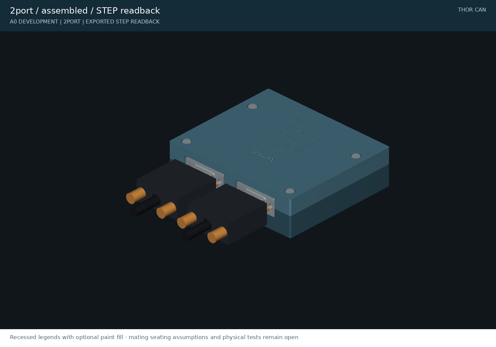
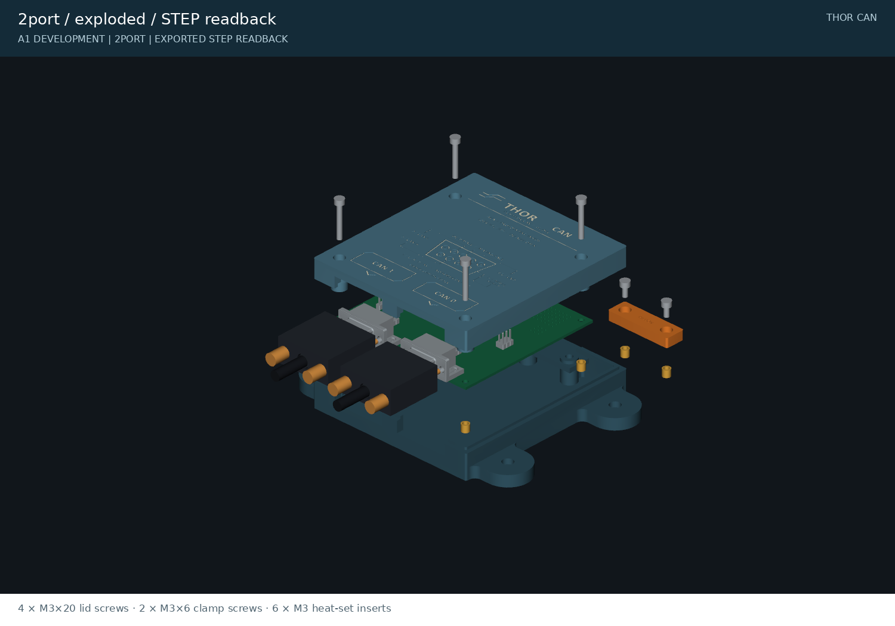
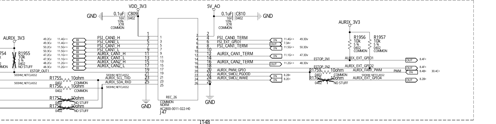
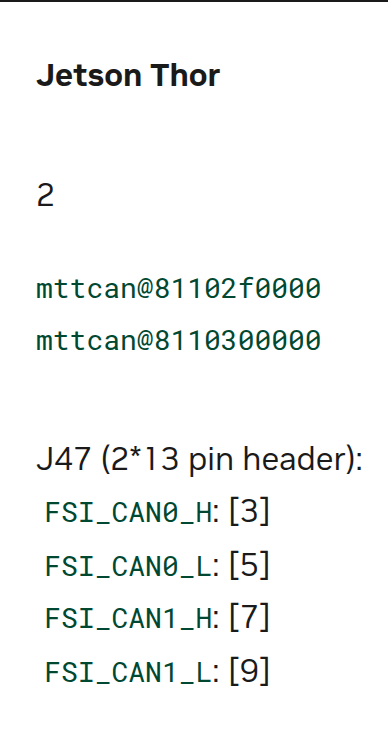
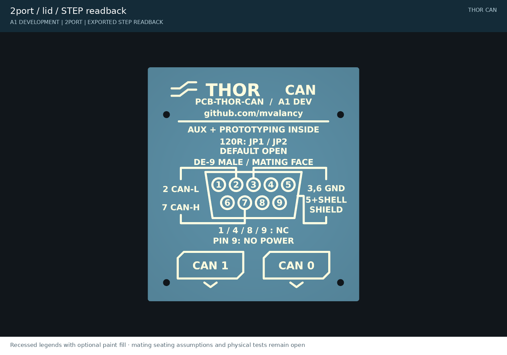

# Thor CAN breakout

Passive CAN adapters and printable housings for NVIDIA Jetson AGX Thor. The adapter brings the carrier's CAN bus signals to male DE9 connectors and the remaining J47 signals to an internal I/O header.

[A1 review](https://github.com/mvalancy/pcb-agx-thor-can-breakout/pull/1) · [Design packages](releases/README.md) · [Assembly guide](ASSEMBLY.md) · [Manufacturing guide](docs/manufacturing.md) · [Validation and open gates](docs/release-checklist.md) · [Local review page](http://localhost:8765/site/)





**A1 engineering prototype — not production qualified.** Both boards pass electrical CAD checks, and the housings pass modeled collision, assembly-path and mesh checks. No physical board or housing has been tested. The exact ribbon/header mating, supplier assembly, CAN operation and transient protection must be verified before connecting an expensive host or ordering 50 units.

## PINOUT proof



© NVIDIA. Direct excerpt from **P4071 A02 concept schematic, sheet 11**. J47 is **Wieson AC2800-0011-022-H0**; read the external contact numbers beside the wires. [Source and capture provenance](docs/pinout-proof.md).



© NVIDIA. The [Jetson Linux r38.2 CAN guide](https://docs.nvidia.com/jetson/archives/r38.2/DeveloperGuide/HR/ControllerAreaNetworkCan.html) independently identifies **CAN0 H/L = 3/5**, **CAN1 H/L = 7/9**, and termination bridges **3–4 / 7–8**. [Full proof, auxiliary mapping and limits](docs/pinout-proof.md). These sources establish documented pins; actual carrier population and all 26 cable conductors still require verification.

## What it does

- Uses the same Wieson **AC2800-0011-022-H0** header identified in Thor's P4071 A02 BOM. Its 26-pad footprint is recovered from NVIDIA's native layout.
- Routes CAN directly to standard CAN DE9 pins: **2 = CAN-L, 7 = CAN-H, 3/6 = ground, 5/shell = shield**. Pins 1/4/8/9 are unconnected; pin 9 supplies no power.
- Adds a **Bourns CDSOT23-SM712 TVS** to each channel. This is a passive breakout, not an isolated repeater or a transceiver board.
- Provides removable links for the carrier's termination resistor, auxiliary power and shield bonding. **All links ship open.**
- Houses the PCB with heat-set inserts, recessed screw heads, a keyed seam and a padded ribbon clamp. The lid carries the pinout, port names, A1 revision and `github.com/mvalancy`.

The TVS is intended to reduce transients; the assembly has no verified surge rating and does not protect against sustained 24 V miswiring. Raw auxiliary I/O has no added protection. See [electrical scope](docs/interface-and-protection.md).

## Choose the right variant

| | Two-port | Four-port engineering variant |
|---|---|---|
| Intended use | AGX Thor FSI CAN0/CAN1 | Generic P4071 A02 full-header investigation |
| Extra channels | Retained on internal J11 for investigation | External ports marked RES2/RES3 |
| IGX compatibility | Not established | **Not established; do not infer it from AURIX net names** |
| PCB | 93 × 65 mm | 177 × 65 mm |
| Housing | 100.2 × 86.2 × 26.8 mm | 184.2 × 86.2 × 26.8 mm |
| Schematic | [PDF](exports/2port/schematic.pdf) | [PDF](exports/4port/schematic.pdf) |
| Copper | [Top](exports/2port/pcb-top.svg) · [Bottom](exports/2port/pcb-bottom.svg) | [Top](exports/4port/pcb-top.svg) · [Bottom](exports/4port/pcb-bottom.svg) |
| Native KiCad project | [Two-port](hardware/2port/thor-2port.kicad_pro) | [Four-port](hardware/4port/thor-4port.kicad_pro) |
| Assembly | [Drawing](exports/2port/assembly.svg) · [BOM](exports/2port/bom-review.csv) | [Drawing](exports/4port/assembly.svg) · [BOM](exports/4port/bom-review.csv) |
| Housing dimensions | [Plan](exports/2port/enclosure-plan.svg) | [Plan](exports/4port/enclosure-plan.svg) |
| Check reports | [Electrical](exports/2port/pcb-evidence.json) · [Mechanical](exports/2port/mechanical-checks.json) | [Electrical](exports/4port/pcb-evidence.json) · [Mechanical](exports/4port/mechanical-checks.json) |

The extra channels in the generic schematic do not prove that a particular AGX or IGX carrier populates or supports them. [Carrier compatibility research](research/igx-compatibility.md).

## Header, ribbon cable and mating connectors

The cable candidate is **Samtec FFSD-13-D-04.00-01-N**, 101.6 mm long, with two 26-position female connectors: [DigiKey SAM10480-ND](https://www.digikey.com/en/products/detail/samtec-inc/FFSD-13-D-04-00-01-N/6561558). Its fit on the actual Wieson header and pin-for-pin continuity are not yet verified. Do not treat the Samtec SHF alternative footprint as an approved Wieson substitute. [Header audit](research/j47-footprint-audit.md).

The board DE9 is **Assmann A-DS 09 A/KG-T2S / C3127392**. Mating clearance models represent **A-DF 09 LL/Z** female connectors with **A-FT 09** backshells and #4-40 thumbscrews. At 42 mm port pitch, maximum-width hood envelopes leave 7.7 mm between neighbors. Actual screw engagement and hood capture still require a sample. [Connector sourcing](research/connector-sourcing.md) · [Mating audit](research/mating-dsub-clearance.md).

## Print and assemble



Use one matching base/lid pair and the common ribbon clamp. Print the insert/counterbore and port coupons first. The [assembly guide](ASSEMBLY.md) and [hardware BOM](exports/enclosure-bom.csv) specify six heat-set inserts, four M3 × 20 lid screws, two M3 × 6 clamp screws, PCB washers and silicone pads.

| Printed part | STL | Quantity |
|---|---|---:|
| Two-port base/lid | [Base](exports/2port_base.stl) · [Lid](exports/2port_lid.stl) | One each for two-port |
| Four-port base/lid | [Base](exports/4port_base.stl) · [Lid](exports/4port_lid.stl) | One each for four-port |
| Common ribbon clamp | [Clamp](exports/ribbon_clamp.stl) | 1 |
| Insert/counterbore coupon | [Coupon](exports/fastener_coupon.stl) | Test first |
| DE9 opening coupon | [Coupon](exports/port_coupon.stl) | Test first |

[STEP and 3MF files](exports/README.md) are also supplied. STL/3MF files are bed-oriented; STEP files use assembly coordinates. The proposed 10 N / 60 s cable pull test has not been performed. White paint fill is optional and is shown in the renders.

## Manufacturing and release status

**A1 is under review in [PR #1](https://github.com/mvalancy/pcb-agx-thor-can-breakout/pull/1) from `dev/a1-routing-lid-review` into `main`.** Review packages are produced locally and by PR CI. Existing [A0 releases](https://github.com/mvalancy/pcb-agx-thor-can-breakout/releases) are historical and superseded: A1 corrects the CAN pair routing and the enclosure's PCB handedness. Do not mix A0 housings with A1 files. [Package structure](releases/README.md).

The [JLCPCB guide](docs/manufacturing.md) explains the Gerber/drill ZIP, SMT-only BOM/CPL and full sourced BOM/CPL. **J1 Wieson procurement/consignment is unresolved**, so this is not a complete turnkey PCBA order. Review placements and supplier DFM before ordering prototypes. No purchase has been made.

Start with 3–5 prototypes. Validate mating and continuity while disconnected from Thor, then check CAN communication, intended bitrates, grounding, protection and housing retention. Proceed toward approximately 50 units only after the [release checklist](docs/release-checklist.md) is closed.

## Local review and reproduction

The [localhost review page](http://localhost:8765/site/) embeds schematic PDFs, PCB layers, dimensions, lid drawings, 3D assemblies and check reports. This link works on the machine running the server; it is not a public web deployment. The site imports the reusable [cad-agent](https://github.com/Valpatel/cad-agent) tools.

Use Python 3.11 or newer, KiCad 10.0.1 and the pinned dependencies. The recorded build used Python 3.12.3; KiCad's Python environment separately supplies `pcbnew`. See the [toolchain record](references/toolchain.json).

```bash
python3 -m venv .venv
.venv/bin/pip install -r requirements.txt
.venv/bin/cad-agent site --serve --port 8765
```

To rebuild and validate the committed routed design:

```bash
.venv/bin/python tools/export_review.py
.venv/bin/python tools/check_electronics.py
# Also run check_can_routing.py and check_fabrication.py with KiCad Python.
.venv/bin/python cad/build.py
.venv/bin/python tools/check_mechanics.py
.venv/bin/python tools/render_review.py
.venv/bin/python tools/draw_mechanics.py
.venv/bin/cad-agent export-3mf
.venv/bin/cad-agent view
.venv/bin/python tools/update_evidence.py
.venv/bin/cad-agent report
.venv/bin/python tools/write_readmes.py
.venv/bin/python tools/validate_release.py --record
.venv/bin/python tools/package_release.py
```

`tools/build_electronics.py` regenerates native sources and overwrites layouts unless `--schematic-only` is used. Full electrical regeneration also requires routing, finalization and all checks. [Tool instructions](tools/README.md) · [Iteration history](docs/iterations.md).

## Project structure

| Folder | Contents |
|---|---|
| [hardware](hardware/README.md) | KiCad projects, interface pin map and pinned footprints |
| [cad](cad/README.md) | Parametric housing source and dimensions |
| [exports](exports/README.md) | Manufacturing review, drawing, print and validation files |
| [preview](preview/README.md) | Rendered assembly and lid views |
| [docs](docs/README.md) | Manufacturing, qualification, decisions and progress |
| [research](research/README.md) | Connector and carrier evidence |
| [references](references/README.md) | Source register and toolchain; vendor archives excluded |
| [tools](tools/README.md) | Generation, checks and release packaging |
| [releases](releases/README.md) | Package structure and release notes |
| [.agents](.agents/README.md) | Engineering lessons and review procedures |
| [.github/workflows](.github/workflows/README.md) | CI and prerelease publication |

Folders have READMEs except `.github` itself: GitHub prioritizes its README over this project overview. CI documentation lives in `.github/workflows/README.md`, and validation prevents recreating the overriding index.

## License

Original work is [MIT licensed](LICENSE). KiCad library derivatives retain CC BY-SA 4.0 and the KiCad design exception; see [third-party notices](THIRD_PARTY.md). Full vendor PDFs and logos are not redistributed. The attributed NVIDIA pinout excerpts retain NVIDIA rights and are excluded from the MIT grant. This project is not affiliated with NVIDIA, Samtec, Assmann or JLCPCB.
