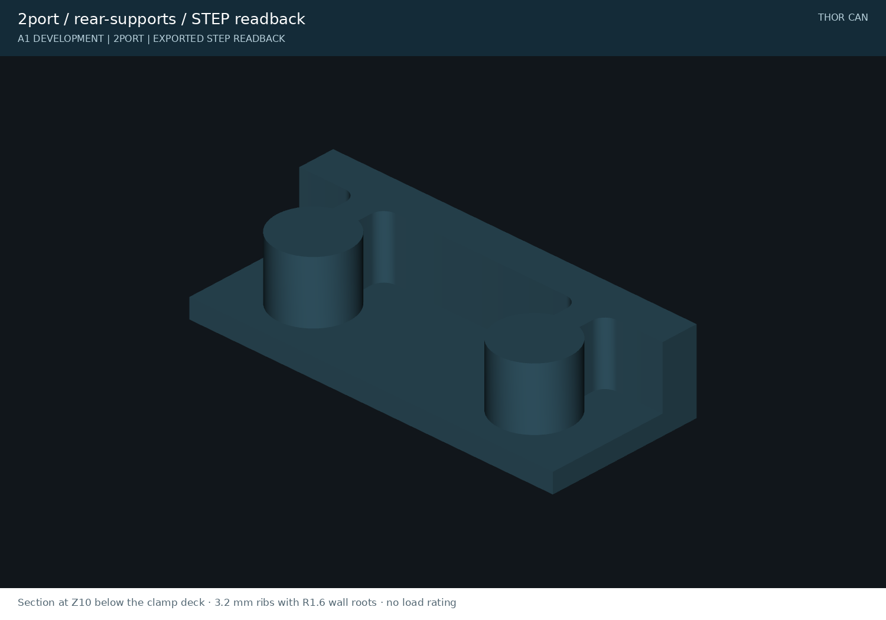
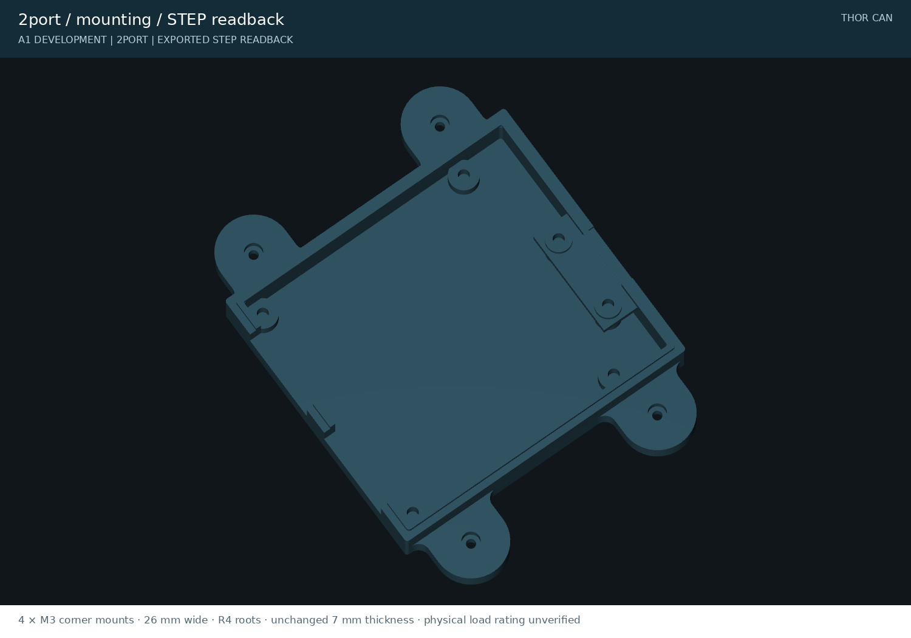

# Enclosure design

A keyed, screw-fastened housing with a separate padded ribbon clamp and enough port spacing for mating DE9 backshells. Both variants share the same seam, hardware and graphical lid language.

## Lid and port identity

The roof carries a numbered **male mating-face** DE9 diagram, CAN-H/L, ground and shield callouts, unconnected pins, port badges, revision and `github.com/mvalancy`. Recessed markings are 0.4 mm deep in a 2.4 mm roof. Light paint fill is optional. The same shared cad-agent vector primitive generates the engraving, paint reference and [SVG proof](../preview/2port-lid-artwork.svg).

Port badges follow the physical PCB orientation. CAN0 is at the right in the housing's top/front coordinate view; the native KiCad PCB view has the opposite X direction after a proper assembly rotation. The four-port model labels its extra channels **RES2 / RES3**.

## Serviceable mechanical details

| Feature | Nominal design |
|---|---|
| Port spacing | 42 mm centers; 9.8 mm plastic rib between openings |
| Mating clearance | 7.7 mm between maximum-width modeled backshells |
| Keyed seam | 2.0 mm tongue width, 1.6 mm height, 0.25 mm clearance |
| Lid hardware | Four M3 × 20 screws, heat-set inserts, Ø6.4 × 3.3 mm counterbores |
| Ribbon clamp | Replaceable bar, two M3 × 6 screws and heat-set inserts |
| Cable contact | Two 0.8 mm silicone pads; 1.8 mm hard-stop gap |
| Lid screw bosses | Ø10.6 mm; 2.1 mm radial web around Ø6.4 counterbores |
| Wall and seam root | 4.5 mm wall; 2.25 mm remaining outside the groove |
| Rear clamp support | Two 3.2 mm ribs, R1.6 wall roots, positive floor/wall overlap |
| Side mounting | Four Ø3.4 M3 holes; Ø6.4 × 3.3 counterbores; 26 mm-wide, 7 mm-thick ears; R4 roots |
| Pilot selection | Print the 3.8 / 3.9 / 4.0 mm insert coupon first |

The mating references include Assmann A-DF 09 LL/Z female connectors, A-FT 09 backshells, #4-40 thumbscrews and cable envelopes. Their dimensions come from drawings; hood capture and screw engagement require physical samples. [Mating audit](../research/mating-dsub-clearance.md).

The section cuts the exported base at Z10 to expose the supports beneath the clamp deck. It shows the actual load-path geometry used in the printable part.

The six exploded screws are four **M3 × 20 lid screws** and two **M3 × 6 clamp screws**; all six engage heat-set inserts. There are no self-tapping screws in this version. The 40 × 12 mm clamp leaves 2.8 mm of plastic at the closest counterbore edge. The modeled structural webs are at least 2 mm, including 2.1 mm at lid counterbores, 2.3 mm under clamp counterbores and 2.0 mm under engraved roof strokes; recessed artwork intentionally uses finer cosmetic strokes. These dimensions improve the load path but are not a printed strength rating.

The four mounting ears belong to the base, two near the corners of each connector-free side. Each is **26 mm wide**, with an **R4 root** spreading to **34 mm at the wall**, while thickness remains **7 mm**. The outer edge leaves 9.8 mm of plastic around the counterbore. Their centers are 10 mm outside the side walls at Y14 and Y90, keeping the front connectors and rear ribbon path clear. Four M3 holes form a **123.2 × 76 mm** pattern on the two-port base or **207.2 × 76 mm** on the four-port base.

M3 socket heads recess below the tab surface; mounting screw length and receiving nut/thread depend on the installation. Both driver access with the lid fitted and the head/shank clearances are checked at all four holes. The actual fused wall-root sections are also measured. Overall sizes including ears are **149.2 × 114.2 × 26.8 mm** and **233.2 × 114.2 × 26.8 mm**. These are geometry checks, not a printed load rating.

The extended PCB has two prototype regions outside the central ribbon lane. A separate clearance check covers components up to 12 mm above the PCB and leads trimmed to 3 mm below it. [Prototype area and controls](termination-and-io.md).

The preferred cable candidate is now the 152.4 mm Samtec assembly. The larger enclosure consumes approximately 57 mm of straight internal span before bend and strain-relief allowances, so the previous 101.6 mm candidate leaves substantially less external reach. Actual cable routing, connector keying and conductor continuity still need a sample.

## Build and inspect

Use the matching base/lid pair plus one common clamp. [Downloads](../exports/README.md) include STL, STEP and 3MF; [ASSEMBLY.md](../ASSEMBLY.md) gives print orientation, hardware, pads and installation. Print the port and insert coupons first. Target a 10 N / 60 s ribbon pull test with continuity checked before and after; this test has not been performed.

CAD checks cover solid validity, meshes, fastener axial stacks, native PCB collisions and assembly paths. They do not establish plastic creep, insert pull-out, cable retention, exact connector fit or allowable screw torque. A0 housings used an improper mirrored PCB frame and are superseded by A1's proper rotation.

[Two-port dimensions](../exports/2port/enclosure-plan.svg) · [Four-port dimensions](../exports/4port/enclosure-plan.svg) · [Local interactive viewer](http://localhost:8765/_cadagent/kit/viewer.html)
