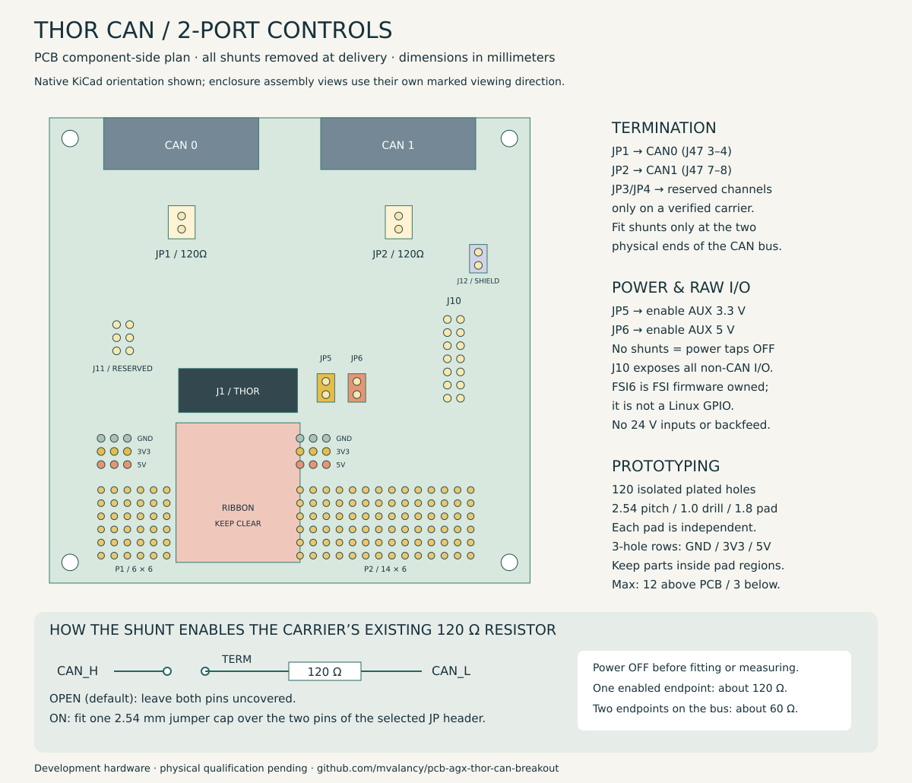
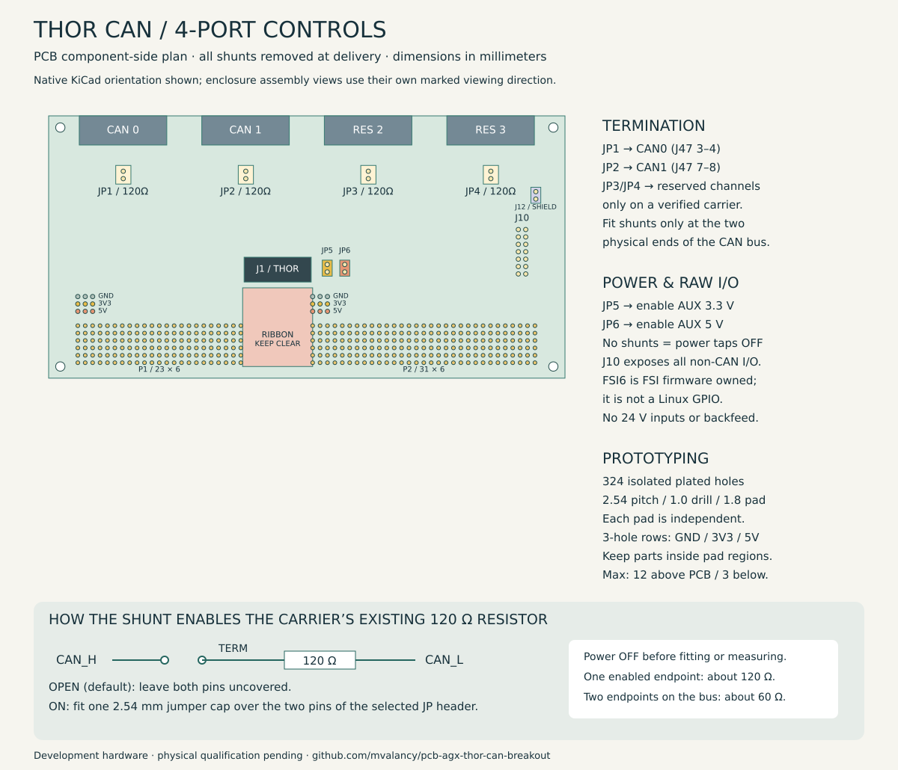

# Termination, power and prototyping

## Enable termination with a jumper cap

The adapter already includes **two-pin, 2.54 mm termination headers**. Fit a removable shunt across both pins of the selected header to connect CAN_H to the carrier's TERM tap, enabling its existing 120 Ω resistor. The resistor is on the carrier; this adapter does not add a second one. Leave all shunts off by default.

| Header | Port | J47 connection closed by shunt | Use |
|---|---|---|---|
| JP1 | CAN0 | 3 to 4 | Supported AGX Thor FSI channel |
| JP2 | CAN1 | 7 to 8 | Supported AGX Thor FSI channel |
| JP3 | RES2 | 11 to 12 | Four-port board only; verify carrier population |
| JP4 | RES3 | 15 to 16 | Four-port board only; verify carrier population |

1. Power down and unplug the Thor before changing jumpers.
2. Identify the two physical ends of the CAN trunk. Enable exactly one 120 Ω termination at each end. Leave intermediate nodes unterminated.
3. Fit a standard 2.54 mm, two-position jumper cap over the two pins of JP1 or JP2 as required. These shunts are loose accessories, not factory solder bridges. The board labels each port, JP reference and `120R`.
4. With the carrier connected, unpowered and isolated from the rest of the CAN bus, an enabled channel should measure approximately 120 Ω between DE9 pins 2 and 7. A complete bus with two enabled endpoints should measure approximately 60 Ω. Check for other termination before interpreting the reading.
5. Never short CAN_H directly to CAN_L. NVIDIA's CAN0↔CAN1 loopback connections are a different test and are not termination jumpers.

NVIDIA documents the two AGX termination pairs in its [Thor CAN guide](https://docs.nvidia.com/jetson/archives/r38.2/DeveloperGuide/HR/ControllerAreaNetworkCan.html). The [pinout proof](pinout-proof.md) preserves the original J47 source excerpt. Reserved-channel termination depends on the actual carrier hardware; this is not an IGX compatibility claim.

## J10 makes the remaining header signals accessible

J10 is a 2×7, 2.54 mm header. Odd pins form one column; even pins the other. Its square pad marks pin 1. The labels beside each row are shortened to stay readable on the PCB.

| Odd pin / silk | Signal | Even pin / silk | Signal |
|---|---|---|---|
| 1 / 3V3 | AUX_3V3, enabled by JP5 | 2 / 5V | AUX_5V_AO, enabled by JP6 |
| 3 / FSI6 | FSI_EXT_GPIO1, J47 pin 6 | 4 / GND | Ground |
| 5 / STOP1 | ESTOP_IN1 | 6 / STOP2 | ESTOP_IN2 |
| 7 / OUT1 | ESTOP_OUT1 | 8 / PWM | AURIX_PWM_GPIO |
| 9 / PGOOD | AURIX_SMCU_PGOOD | 10 / WAKE | AURIX_SMCU_WAKE |
| 11 / SCL | AURIX_SCL_TXD | 12 / SDA | AURIX_SDA_RXD |
| 13 / GND | Ground | 14 / GND | Ground |

Every J47 pin is retained: CAN bus lines at the DE9 ports, TERM taps at JP1–JP4, the two supply rails through JP5/JP6, all other signals and ground at J10, and the six reserved CAN pins at J11 on the two-port adapter. This is electrical access to the source nets, not a guarantee that each signal is populated or supported by a particular carrier.

### What FSI_EXT_GPIO1 actually does

P4071 A02 sheet 7 traces `FSI_EXT_GPIO1` to module contact **J39 / FSI_GPIO06**; sheet 11 brings it to **J47 pin 6**, which this board routes to **J10 pin 3**. It is a raw FSI-domain signal. NVIDIA states that FSI_GPIO05/06 are controlled by FSI firmware and are not normal Linux runtime GPIOs on current Thor L4T. See the [September 2026 NVIDIA clarification](https://forums.developer.nvidia.com/t/question-about-can-stb-control-using-fsi-gpio05-06-in-the-jetson-thor-reference-design/383203) and [earlier FSI_GPIO06 discussion](https://forums.developer.nvidia.com/t/jetson-agx-thor-carrier-board-gpio/351770).

Keep it available for carrier-specific or future firmware work, but do not present it as a Linux `libgpiod` output. The reference schematic also marks FSI GPIO support limitations. We have not qualified its configured direction, electrical limits or custom FSI firmware. Do not drive it externally until those are established. Likewise, labels such as ESTOP, PWM, SCL and SDA preserve source names; they do not make this adapter a qualified safety interface, general PWM controller or Linux I²C adapter.

## Prototype power is off until deliberately enabled

- **JP5:** a shunt connects host 3.3 V to J10 pin 1 and both 3V3 prototype rows.
- **JP6:** a shunt connects host 5 V always-on to J10 pin 2 and both 5V prototype rows. The source may remain powered when the host is otherwise inactive; unplug the host supply before wiring.
- **GND:** both prototype ground rows and J10 ground pins are connected directly to host ground.
- **J12:** optional shield-to-ground bond, left open by default. It is not a power or CAN termination link.

There is no regulator, fuse, reverse-current blocking or I/O level translator in these auxiliary paths. Available current at J47 has not been qualified. Start with unpowered continuity testing and a measured, low-current circuit only after confirming the carrier's power budget. Do not connect external power to these taps or backfeed the Thor. No raw I/O is qualified for 5 V, 12 V or 24 V signaling merely because those supply names appear elsewhere on the board.

## A useful area to build on

| Version | P1 | P2 | Independent pads | Power taps |
|---|---|---|---:|---|
| Two-port, 93 × 90 mm | 6 columns × 6 rows | 14 columns × 6 rows | 120 | Two banks of 3 GND + 3 AUX 3V3 + 3 AUX 5V holes |
| Four-port, 177 × 90 mm | 23 columns × 6 rows | 31 columns × 6 rows | 324 | Same two power banks |

The grid uses **2.54 mm pitch, 1.0 mm plated drills and 1.8 mm pads**. Rows A–F and numbered columns locate individual holes. Each free pad is electrically independent: there are no hidden stripboard connections or automatic ground fills. Bare pads and rails are excluded from assembly BOM/CPL. Three holes in each labeled power row are connected together; the rows are distinct from the isolated grid.

Keep components within the grid's bounding rectangle plus 0.5 mm on each side, at most **12 mm above the PCB** and trimmed to at most **3 mm below it**. These envelopes are checked against the exported housing, clamp and ribbon. Keep the central ribbon lane clear. Wire raw I/O from J10 as needed; signal compatibility still requires a circuit-specific review. User-added circuits require fresh electrical and mechanical checks.

[Native design files](../hardware/README.md) · [Assembly instructions](../ASSEMBLY.md) · [Protection limits](interface-and-protection.md)
