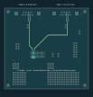

<!-- generated by tools/write_readmes.py -->
# 2-port design package

[Project overview](../../README.md) · [Documentation](../../docs/README.md) · [Local design review](http://localhost:8765/site/)

Generated review and manufacturing inputs for the documented AGX Thor FSI CAN0/CAN1 interface.

## Inspect the design

[Schematic PDF](schematic.pdf) · [Top copper](pcb-top.svg) · [Bottom copper](pcb-bottom.svg) · [Assembly drawing](assembly.svg) · [Enclosure dimensions](enclosure-plan.svg) · [Controls and prototype map](controls.svg)

## Prepare a quote

| File | Use |
|---|---|
| [Fabrication ZIP](thor-2port-A1-fabrication-REVIEW.zip) | Gerbers and separate plated/non-plated drills |
| [SMT BOM](jlc-bom.csv) + [CPL](jlc-cpl.csv) | Exact Bourns TVS population only |
| [Full sourced BOM](jlc-full-bom.csv) + [CPL](jlc-full-cpl.csv) | Adds sourced headers/DE9; Wieson J1 still manual or consigned |
| [Manual assembly](manual-assembly.csv) | Parts outside the TVS-only population |
| [Complete review BOM](bom-review.csv) | Engineering sourcing and disposition |

## Evidence

[Native electrical](pcb-evidence.json) · [Pin mapping](electrical-review.json) · [Pair routing](can-routing-review.json) · [Fabrication profile](fabrication-profile-check.json) · [Prototype pads](prototype-review.json) · [Housing](mechanical-checks.json) · [Assembly paths](assembly-paths.json)

Read [manufacturing instructions](../../docs/manufacturing.md) before upload. The local fabrication-profile report is **not JLCDFM approval**. Stock, J1 sourcing, placement rotations, panelization and physical testing remain open. Keep this variant's files together.

Complete folder index

| File or folder | Purpose |
|---|---|
| [fabrication-review/](fabrication-review/README.md) | 2-port fabrication layers |
| [assembly-file-checks.json](assembly-file-checks.json) | Machine-readable design evidence |
| [assembly-paths.json](assembly-paths.json) | Assembly insertion-path checks |
| [assembly.svg](assembly.svg) | Scalable drawing |
| [bom-review.csv](bom-review.csv) | Assembly or sourcing table |
| [can-routing-review.json](can-routing-review.json) | Measured paired paths and return-plane coverage |
| [can-routing.svg](can-routing.svg) | Scalable drawing |
| [components.json](components.json) | Machine-readable design evidence |
| [controls.svg](controls.svg) | Scalable drawing |
| [drc.json](drc.json) | Native layout, connectivity and parity check |
| [electrical-review.json](electrical-review.json) | Independent connector/TVS semantic checks |
| [enclosure-plan.svg](enclosure-plan.svg) | Scalable drawing |
| [erc.json](erc.json) | Native schematic rule check |
| [fabrication-profile-check.json](fabrication-profile-check.json) | Feature measurements and native-rule negative control |
| [jlc-bom.csv](jlc-bom.csv) | Assembly or sourcing table |
| [jlc-cpl.csv](jlc-cpl.csv) | Assembly or sourcing table |
| [jlc-full-bom.csv](jlc-full-bom.csv) | Assembly or sourcing table |
| [jlc-full-cpl.csv](jlc-full-cpl.csv) | Assembly or sourcing table |
| [lid-markings-review.json](lid-markings-review.json) | Native engraved lettering and roof/screw clearances |
| [lid-slicing-review.json](lid-slicing-review.json) | Offline lid-only slicing and toolpath evidence |
| [manual-assembly.csv](manual-assembly.csv) | Assembly or sourcing table |
| [mechanical-checks.json](mechanical-checks.json) | Solid collision, fastener and cable envelope checks |
| [netlist.xml](netlist.xml) | Project support file |
| [pcb-bottom.svg](pcb-bottom.svg) | Scalable drawing |
| [pcb-evidence.json](pcb-evidence.json) | Source freshness and open qualification gates |
| [pcb-top.svg](pcb-top.svg) | Scalable drawing |
| [pcb.step](pcb.step) | Solid model in assembly coordinates |
| [positions-kicad.csv](positions-kicad.csv) | Assembly or sourcing table |
| [prototype-review.json](prototype-review.json) | Machine-readable design evidence |
| [schematic.pdf](schematic.pdf) | Printable review drawing |
| [thor-2port-A1-fabrication-REVIEW.zip](thor-2port-A1-fabrication-REVIEW.zip) | Engineering review archive |

