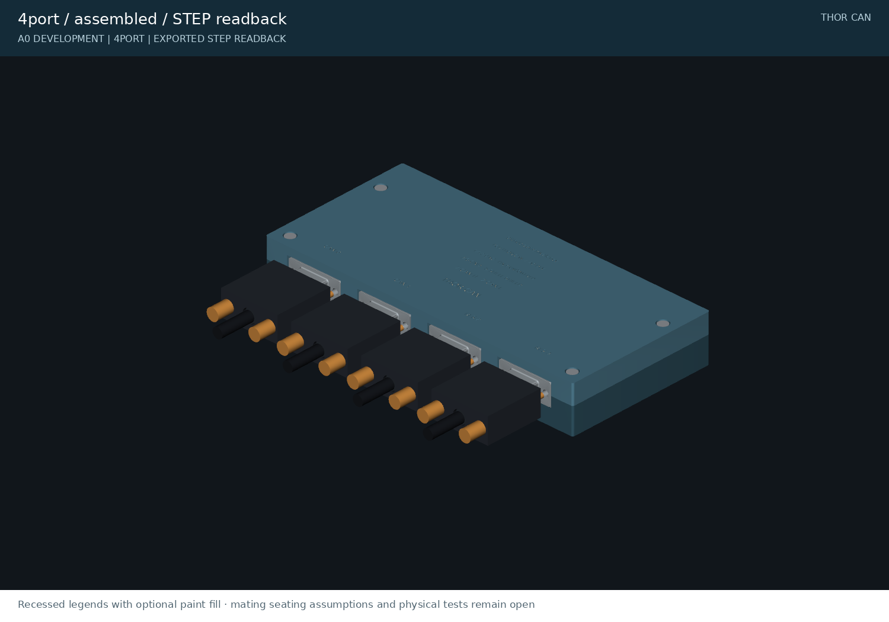

<!-- generated by tools/write_readmes.py -->
# preview

[Project overview](../README.md)

Current rendered evidence of assembly, cable retention and housing geometry.

**A0 engineering prototype.** CAD checks do not establish physical fit, electrical protection or production readiness.

| Item | Kind |
|---|---|
| [2port-assembled.png](2port-assembled.png) | png |
| [2port-exploded.png](2port-exploded.png) | png |
| [2port-lid.png](2port-lid.png) | png |
| [2port-open.png](2port-open.png) | png |
| [4port-assembled.png](4port-assembled.png) | png |
| [4port-exploded.png](4port-exploded.png) | png |
| [4port-lid.png](4port-lid.png) | png |
| [4port-open.png](4port-open.png) | png |
