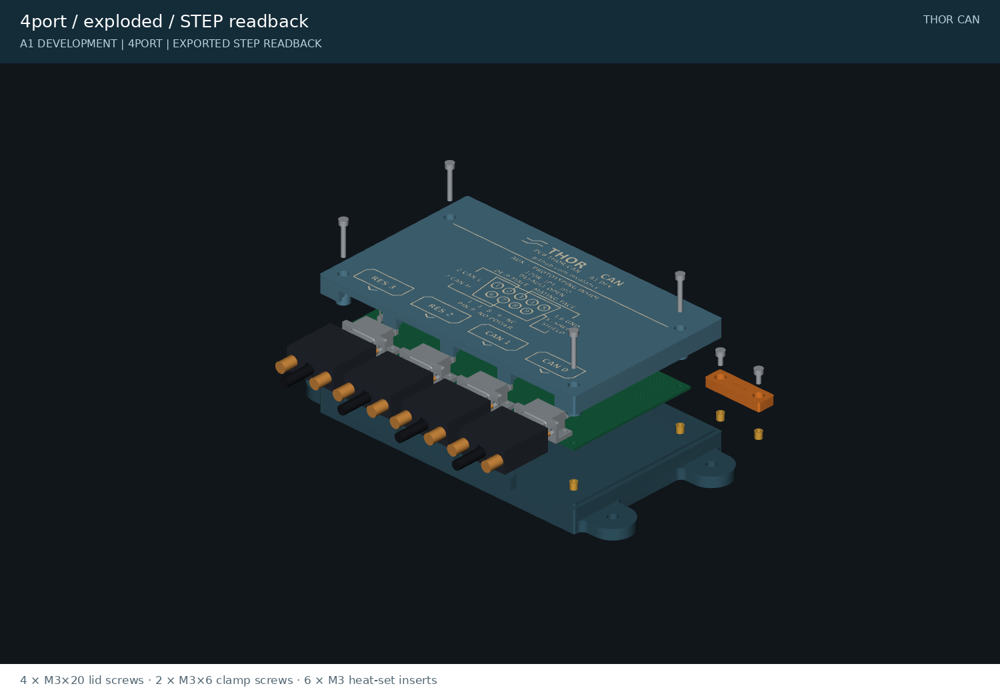

<!-- generated by tools/write_readmes.py -->
# Product views

[Project overview](../README.md) · [Documentation](../docs/README.md) · [Local design review](http://localhost:8765/site/)

Current images rendered from exported STEP readbacks, plus dimensioned drawings and the exact lid artwork.

## Assembled and exploded

| Two-port AGX adapter | Four-port engineering variant |
|---|---|
|  |  |
|  |  |

## Lid identity

[Two-port vector artwork](2port-lid-artwork.svg) · [Four-port vector artwork](4port-lid-artwork.svg). Bold 4 mm body-text size, enlarged pin numbers and 1 mm graphic strokes drive the actual 0.4 mm engraving. Light paint fill is optional.

Open views show the native PCB, ribbon clamp, mating female connectors, backshells and thumbscrews. Those connector envelopes use drawing dimensions and stated seating assumptions; a render does not establish physical fit. [Enclosure details](../docs/enclosure.md).

Complete folder index

| File or folder | Purpose |
|---|---|
| [2port-assembled.png](2port-assembled.png) | Rendered design evidence |
| [2port-exploded.png](2port-exploded.png) | Rendered design evidence |
| [2port-lid-artwork.svg](2port-lid-artwork.svg) | Scalable drawing |
| [2port-lid-first-layer.svg](2port-lid-first-layer.svg) | Scalable drawing |
| [2port-lid.png](2port-lid.png) | Rendered design evidence |
| [2port-mounting.png](2port-mounting.png) | Rendered design evidence |
| [2port-open.png](2port-open.png) | Rendered design evidence |
| [2port-rear-supports.png](2port-rear-supports.png) | Rendered design evidence |
| [2port_base.png](2port_base.png) | Rendered design evidence |
| [2port_lid.png](2port_lid.png) | Rendered design evidence |
| [4port-assembled.png](4port-assembled.png) | Rendered design evidence |
| [4port-exploded.png](4port-exploded.png) | Rendered design evidence |
| [4port-lid-artwork.svg](4port-lid-artwork.svg) | Scalable drawing |
| [4port-lid-first-layer.svg](4port-lid-first-layer.svg) | Scalable drawing |
| [4port-lid.png](4port-lid.png) | Rendered design evidence |
| [4port-mounting.png](4port-mounting.png) | Rendered design evidence |
| [4port-open.png](4port-open.png) | Rendered design evidence |
| [4port-rear-supports.png](4port-rear-supports.png) | Rendered design evidence |
| [4port_base.png](4port_base.png) | Rendered design evidence |
| [4port_lid.png](4port_lid.png) | Rendered design evidence |
| [fastener_coupon.png](fastener_coupon.png) | Rendered design evidence |
| [port_coupon.png](port_coupon.png) | Rendered design evidence |
| [ribbon_clamp.png](ribbon_clamp.png) | Rendered design evidence |

